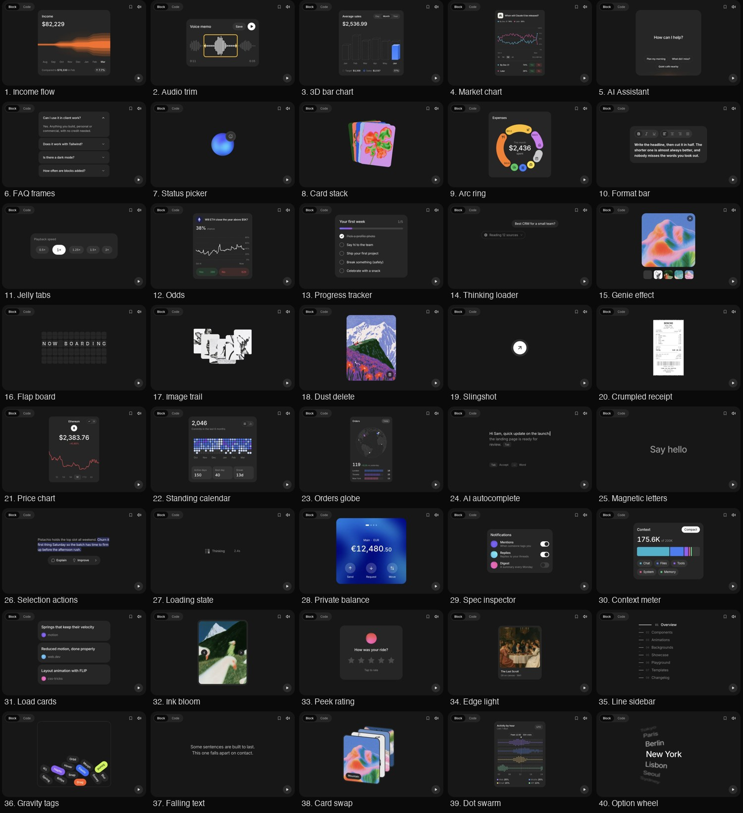
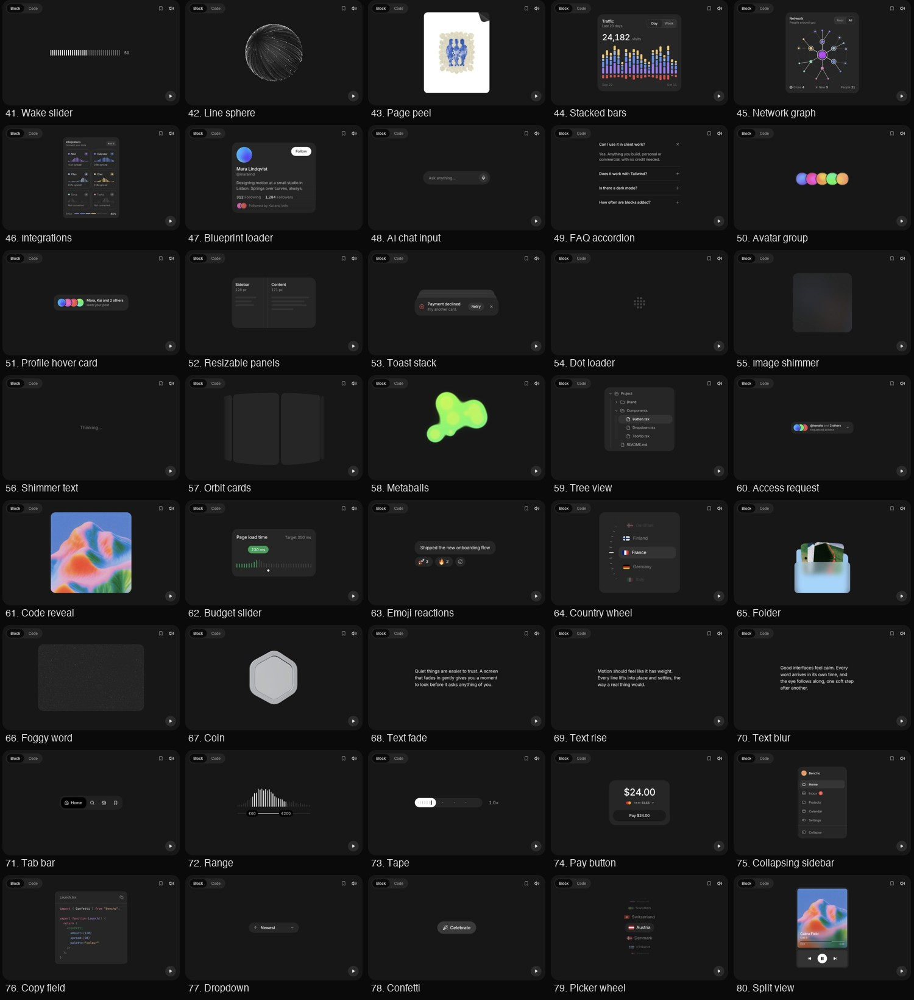
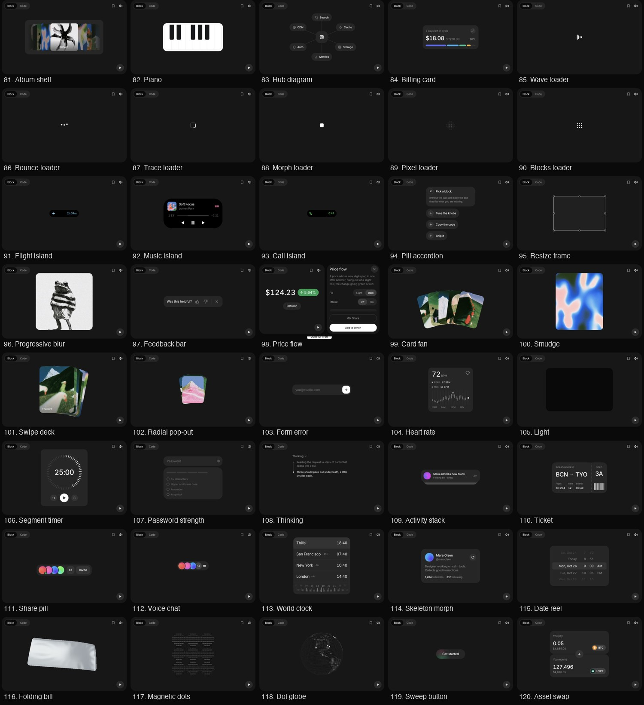
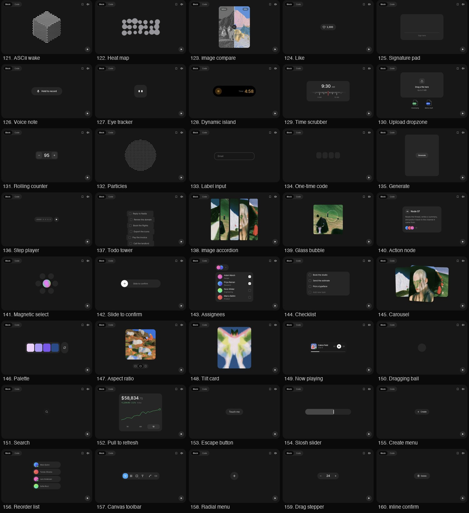
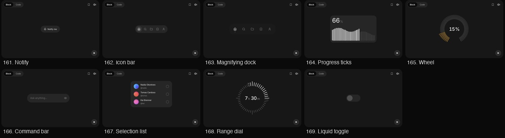

# Bencho component index

Studied 17 November 2026. All 169 entries were opened individually. The 47 free entries expose live components and public source; 122 Pro entries expose static preview images and descriptions in this session.

Behavior notes are paraphrased observations and interpretations of each linked page. For Pro entries they describe documented behavior, not a verified animation implementation. Control summaries are observed defaults and available choices. Light/dark presentation and stroke controls are usually omitted from the summary to keep it readable.

The trigger column preserves the catalog label. Some components support additional gestures: for example Card swap also responds to presses, and Wake slider supports keyboard changes. The linked source and page are the authority for implementation.

See the [builder reference](bencho-builder-reference.md), [machine-readable reference](bencho-reference.json), and [theme tokens](bencho-tokens.css).

## Catalog overview

| Trigger | Entries |
| --- | ---: |
| Hover | 45 |
| Press | 57 |
| Drag | 36 |
| Slide | 2 |
| Swipe | 4 |
| Type | 7 |
| Select | 6 |
| Loading | 12 |

## Every component

### 1–40

| # | Component | Trigger | Behavior to preserve | Controls / defaults | Evidence |
| ---: | --- | --- | --- | --- | --- |
| 1 | [Income flow](https://bencho.dev/blocks/income-flow) | Hover | Ribbon thickness encodes income; hover anchors the month, and year changes reshape the entire ribbon. | Hue: Orange/Violet/Blue (default Orange); Colour: Colour/Mono (default Colour) | Pro: still + description |
| 2 | [Audio trim](https://bencho.dev/blocks/wave-trim) | Drag | Trim handles frame a waveform; phrase snapping, scrubbing, playback and save feedback share the selection. | Colour: Colour/Mono (default Colour); Effect: Card/Bars (default Card) | Pro: still + description |
| 3 | [3D bar chart](https://bencho.dev/blocks/pillars) | Hover | Perspective wireframes show targets; the hovered column fills upward with the actual value. | Colour: Colour/Mono (default Colour); Depth 12px | Pro: still + description |
| 4 | [Market chart](https://bencho.dev/blocks/market-chart) | Hover | Several probability lines share a scrub cursor, value tags and a faded future region. | Answers: 2/3 (default 2); Fade 88% | Pro: still + description |
| 5 | [AI Assistant](https://bencho.dev/blocks/listen) | Press | A minimal assistant moves through prompt suggestions, voice activity, thinking and streamed output. | Theme: Sunset/Ocean (default Sunset); Glow 1.0 | Pro: still + description |
| 6 | [FAQ frames](https://bencho.dev/blocks/faq-frames) | Press | Individual question cards expand while surrounding cards recede in emphasis. | Fade the others; Bounce 3px | Pro: still + description |
| 7 | [Status picker](https://bencho.dev/blocks/status-picker) | Press | A status badge expands around a glowing orb, then folds the selected status back into itself. | Bounce 35; Size 128px; Hue 220° | Pro: still + description |
| 8 | [Card stack](https://bencho.dev/blocks/card-stack) | Hover | A tight photo pile spreads into a fan; selection lifts and flips a card into a larger view. | Spread 85; Bounce 5; Scatter 0; Cards 5; Corner 14 | Free: live + source |
| 9 | [Arc ring](https://bencho.dev/blocks/expenses) | Hover | Rounded ring segments redistribute space around the hovered category while the center amount changes. | Colour: Colour/Mono (default Colour); Thickness 38px | Pro: still + description |
| 10 | [Format bar](https://bencho.dev/blocks/format-bar) | Press | Active formatting marks join visually; alignment and text styling animate with the toolbar. | Lean 9° | Pro: still + description |
| 11 | [Jelly tabs](https://bencho.dev/blocks/jelly-tabs) | Press | A shared selection pill changes position and width with a short, soft wobble. | Wobble 67 | Pro: still + description |
| 12 | [Odds](https://bencho.dev/blocks/odds) | Press | Historical probability scrubbing pairs with press-and-hold actions that move a binary split. | Fill / Stroke presentation controls | Pro: still + description |
| 13 | [Progress tracker](https://bencho.dev/blocks/progress-tracker) | Press | Task completion coordinates checkbox, strike-through, count and progress, with a final staggered celebration. | Sparks; Bounce 40 | Pro: still + description |
| 14 | [Thinking loader](https://bencho.dev/blocks/thinking-loader) | Loading | A compact status pill combines rotating marks, changing step text and a completion check. | Shine; Step 2000ms | Pro: still + description |
| 15 | [Genie effect](https://bencho.dev/blocks/genie) | Press | A photo expands from its dock origin and funnels back to that same slot. | Speed 600ms | Pro: still + description |
| 16 | [Flap board](https://bencho.dev/blocks/flap-board) | Press | Split-flap characters update with a cascading sweep; pointer movement can disturb individual flaps. | Cascade: Sweep/Scatter (default Sweep); Flap 70ms | Pro: still + description |
| 17 | [Image trail](https://bencho.dev/blocks/image-trail) | Hover | Pointer travel emits photos at distance intervals; each item has its own short exit. | Leave: Shrink/Drop (default Shrink); Spacing 80px; Size 96px | Pro: still + description |
| 18 | [Dust delete](https://bencho.dev/blocks/dust-delete) | Press | A destructive photo action dissolves the image into directional particles, then introduces its replacement. | Effect: Pour/Ash/Wind/Pieces (default Pour); Wind: Right/Left (default Right); Speed 60; Grain 3px | Pro: still + description |
| 19 | [Slingshot](https://bencho.dev/blocks/slingshot) | Drag | Pointer tension stretches a tether; release transfers momentum into a bouncing projectile and return. | Power 100; Bounce 30 | Free: live + source |
| 20 | [Crumpled receipt](https://bencho.dev/blocks/crumple) | Drag | A paper receipt collapses into a throwable object; reaching the bin triggers a fresh receipt. | Bin label; Tilt 5°; Throw 100% | Pro: still + description |
| 21 | [Price chart](https://bencho.dev/blocks/price-chart) | Drag | Scrubbing updates price and change together; range changes and line-to-candle conversion preserve continuity. | Colour: Colour/Mono (default Colour); Price: Above/Below (default Above); Morph 600ms; Corner 20px | Pro: still + description |
| 22 | [Standing calendar](https://bencho.dev/blocks/standing-calendar) | Press | A contribution grid can rise into a rotatable skyline with day values encoded as height. | View: Book/Skyline (default Book); Shape: Squares/Circles (default Squares); Colour: Colour/Mono (default Colour); Wave 50; Height 60 | Pro: still + description |
| 23 | [Orders globe](https://bencho.dev/blocks/orders-globe) | Drag | A draggable dotted globe shows city shares alongside a compact time-window selector. | Colour: Colour/Mono (default Colour); Rate 40; Speed 30 | Pro: still + description |
| 24 | [AI autocomplete](https://bencho.dev/blocks/ai-autocomplete) | Type | Low-emphasis continuation text follows the caret and supports whole-suggestion or wordwise acceptance. | Pause 500ms; Stream 45ms | Pro: still + description |
| 25 | [Magnetic letters](https://bencho.dev/blocks/magnetic-letters) | Hover | Pointer proximity controls individual letter displacement, tilt and darkness, with a spring return. | Pull 50; Reach 160px; Tilt 10° | Pro: still + description |
| 26 | [Selection actions](https://bencho.dev/blocks/selection-actions) | Press | Selected text owns an adjacent action pill that can expand into editing or note content. | Think 900ms | Pro: still + description |
| 27 | [Loading state](https://bencho.dev/blocks/loading-state) | Loading | A small pixel pattern, changing action label and elapsed time describe ongoing work. | Grid: Drive/Dots/Orbit (default Drive) | Pro: still + description |
| 28 | [Private balance](https://bencho.dev/blocks/private-balance) | Press | Account swipes roll the amount; concealment progresses across digits, with a temporary hold-to-peek state. | Background: Image/Plain (default Image); Mask: Dots/Dashes/Blur (default Dots); Wave 30ms | Pro: still + description |
| 29 | [Spec inspector](https://bencho.dev/blocks/spec-inspector) | Drag | A dragged inspection frame reveals measurements and blueprint styling over the same live layout. | Fill / Stroke presentation controls | Pro: still + description |
| 30 | [Context meter](https://bencho.dev/blocks/context-meter) | Hover | Category highlighting links legend and allocation graphic; compaction shrinks the represented context usage. | Style "Bar"; Colour "Colour" | Free: live + source |
| 31 | [Load cards](https://bencho.dev/blocks/load-cards) | Press | Skeletons enter softly, then resolve into content in sequence with matching geometry. | Pace 380ms; Blur 6px | Pro: still + description |
| 32 | [Ink bloom](https://bencho.dev/blocks/ink-bloom) | Press | The next photo spreads from the interaction point with a rough liquid boundary and lens distortion. | Edge 50; Speed 50 | Pro: still + description |
| 33 | [Peek rating](https://bencho.dev/blocks/peek-rating) | Hover | Proximity raises neighboring rating icons; the current choice grows and gains a score tooltip. | Colour: Colour/Mono (default Colour); Shape: Star/Heart (default Star); Lift 50 | Pro: still + description |
| 34 | [Edge light](https://bencho.dev/blocks/edge-light) | Hover | A small illuminated rim segment follows pointer direction around the picture frame. | Colour; Edge 40%; Tilt 20; Glow 80 | Pro: still + description |
| 35 | [Line sidebar](https://bencho.dev/blocks/line-sidebar) | Hover | A ruler-like contents list expands around the cursor, with shorter responses farther from it. | Reach 50; Length 40 | Pro: still + description |
| 36 | [Gravity tags](https://bencho.dev/blocks/gravity-tags) | Hover | Rigid tags or orbs fall into a pile; cursor speed determines whether they nudge or scatter. | Shape: Tags/Orbs (default Tags); Colour: Colour/Mono (default Colour); Gravity 1800px/s²; Push 50; Count 13 | Pro: still + description |
| 37 | [Falling text](https://bencho.dev/blocks/falling-text) | Hover | A sentence breaks into physical words, allows disturbance, then reassembles into its original order. | Gravity 1800px/s² | Pro: still + description |
| 38 | [Card swap](https://bencho.dev/blocks/card-swap) | Drag | The front photo cycles behind the stack while the remaining cards advance into the vacated depth. | Auto false; Every 4 | Free: live + source |
| 39 | [Dot swarm](https://bencho.dev/blocks/dot-swarm) | Hover | Dense hourly dot columns swell under the cursor and provide a local activity readout. | Colour: Mono/Colour (default Colour); Density 4; Rows 4 | Pro: still + description |
| 40 | [Option wheel](https://bencho.dev/blocks/option-wheel) | Drag | A vertical text drum keeps the selected item sharp while neighboring items rotate and blur away. | Blur 4px; Tilt 60 | Pro: still + description |

### 41–80

| # | Component | Trigger | Behavior to preserve | Controls / defaults | Evidence |
| ---: | --- | --- | --- | --- | --- |
| 41 | [Wake slider](https://bencho.dev/blocks/wake-slider) | Drag | A thumb-free bar track retains a velocity-dependent wake behind a fast drag. | Bars 36; Wake 60 | Free: live + source |
| 42 | [Line sphere](https://bencho.dev/blocks/line-sphere) | Hover | Fine lines interpolate between spherical and flat forms and part around the pointer. | Reach 80%; Sway 3; Lines 720 | Pro: still + description |
| 43 | [Page peel](https://bencho.dev/blocks/page-peel) | Drag | A curled corner follows a drag to expose underlying content, then settles back when released. | Bounce 50; Curl 36px; Reach 50% | Pro: still + description |
| 44 | [Stacked bars](https://bencho.dev/blocks/stacked-bars) | Hover | Hover links a daily bar to a moving tooltip; aggregation changes regrow the data columns. | Colour "Colour"; Bars 20; Gap 6 | Free: live + source |
| 45 | [Network graph](https://bencho.dev/blocks/blast-radius) | Hover | Hover reveals a node's route to the center; changing scope introduces an outer network ring. | Colour: Mono/Colour (default Colour); Reach: Near/All (default All); Shape: Circle/Square (default Circle); Counts; Corner 20px | Pro: still + description |
| 46 | [Integrations](https://bencho.dev/blocks/connect-sources) | Press | Tool tiles toggle connection state; their sparklines and a shared completion indicator respond together. | Colour: Mono/Colour (default Colour); Connected 4 | Pro: still + description |
| 47 | [Blueprint loader](https://bencho.dev/blocks/blueprint-loader) | Loading | Measured outlines establish the card layout before the finished profile surface appears. | Speed 50 | Pro: still + description |
| 48 | [AI chat input](https://bencho.dev/blocks/ai-chat-input) | Type | A compact composer expands around focus; model, effort and attachment controls accompany a changing send action. | Attach; Model; Effort; Bounce 40 | Pro: still + description |
| 49 | [FAQ accordion](https://bencho.dev/blocks/faq-accordion) | Press | Answer height, staggered words and the expanding icon coordinate each question's open state. | One at a time; Icon: Plus/Chevron (default Plus) | Pro: still + description |
| 50 | [Avatar group](https://bencho.dev/blocks/avatar-group) | Hover | Overlapping faces lift with proximity while one shared tooltip moves between people. | Lift 4px; Grow 5%; Overlap 8px | Pro: still + description |
| 51 | [Profile hover card](https://bencho.dev/blocks/profile-card) | Hover | A delayed hover opens a profile from its avatar; moving across avatars changes the profile in place. | Delay 400ms; Corner 20px | Pro: still + description |
| 52 | [Resizable panels](https://bencho.dev/blocks/resizable-panels) | Drag | Dividers trade pane width, add resistance near minimum size and support collapsing beyond that limit. | Panels: 2/3 (default 2); Corner 20px | Pro: still + description |
| 53 | [Toast stack](https://bencho.dev/blocks/toast-stack) | Hover | Depth-compressed notifications unfold into a spaced list, retaining independent retry and dismissal actions. | Peek 14; Gap 10; Corner 20 | Free: live + source |
| 54 | [Dot loader](https://bencho.dev/blocks/dot-loader) | Loading | A compact dot matrix supports several repeating illumination patterns and adjustable speed. | Pattern: 1/2/3/4 (default 2); Rounded; Speed 20 | Pro: still + description |
| 55 | [Image shimmer](https://bencho.dev/blocks/image-shimmer) | Loading | Moving light gives an otherwise empty image placeholder a quiet loading state. | Speed 50; Corner 20px | Pro: still + description |
| 56 | [Shimmer text](https://bencho.dev/blocks/shimmer-text) | Loading | A traveling contrast band animates a short status phrase; interaction cycles the phrase. | Speed 50 | Pro: still + description |
| 57 | [Orbit cards](https://bencho.dev/blocks/orbit-cards) | Drag | A draggable rotating band gives front-facing cards prominence and bends the side cards away. | Speed 40; Tilt 0° | Pro: still + description |
| 58 | [Metaballs](https://bencho.dev/blocks/metaballs) | Hover | Moving colored blobs merge and separate; the pointer contributes an additional blob. | Colors: Blue/Red/Green (default Green); Speed 10; Orbs 8; Glow 0 | Pro: still + description |
| 59 | [Tree view](https://bencho.dev/blocks/tree-view) | Press | Folder rows reveal nested children under their own position while selection stays local to files. | Guides; Indent 22px; Corner 20px | Pro: still + description |
| 60 | [Access request](https://bencho.dev/blocks/access-request) | Press | An avatar summary grows into requests with individual approval and rejection actions. | Speed 90; Bounce 40; Corner 20px | Pro: still + description |
| 61 | [Code reveal](https://bencho.dev/blocks/code-reveal) | Hover | A pointer-local transformation replaces picture detail with image-derived monochrome characters. | Reach 25; Linger 50; Cell 5px; Corner 20px | Pro: still + description |
| 62 | [Budget slider](https://bencho.dev/blocks/budget-slider) | Drag | The selected load time controls bar emphasis and semantic green, amber or red budget feedback. | Budget 300ms | Pro: still + description |
| 63 | [Emoji reactions](https://bencho.dev/blocks/emoji-reactions) | Hover | A message becomes a reaction picker; the chosen emoji travels into its chip as the count rolls. | Magnify 50; Bounce 45; Set "Work"; Corner 20 | Free: live + source |
| 64 | [Country wheel](https://bencho.dev/blocks/country-wheel) | Drag | A flag drum and curved ruler combine inertial movement with a clearly fixed selection slot. | List: Countries/Currencies (default Countries); Ruler; Curve 55; Corner 20px | Pro: still + description |
| 65 | [Folder](https://bencho.dev/blocks/folder) | Hover | A folder front tilts as its contents fan upward; individual hovered photos rise further. | Colour · Blue · Pink · Lilac · Spread 8° | Pro: still + description |
| 66 | [Foggy word](https://bencho.dev/blocks/foggy-word) | Hover | The pointer clears a local path through condensation, which returns over time. | Behind · Word · Image · Wipe 18px · Fog back 20s · Drips 40 · Fog 60 · Corner 20px | Pro: still + description |
| 67 | [Coin](https://bencho.dev/blocks/coin) | Drag | A raised metal token tilts toward the cursor and retains angular momentum after a spin. | Shape · Hex · Round · Metal · Silver · Graphite · Float 50 | Pro: still + description |
| 68 | [Text fade](https://bencho.dev/blocks/text-fade) | Press | Opacity introduces a paragraph by whole block, line, word or character. | Reveal · Whole · Lines · Words · Letters · Speed 1.0x | Pro: still + description |
| 69 | [Text rise](https://bencho.dev/blocks/text-rise) | Press | Vertical motion introduces text with a configurable unit of staggering. | Reveal · Whole · Lines · Words · Letters · Speed 1.0x | Pro: still + description |
| 70 | [Text blur](https://bencho.dev/blocks/text-blur) | Press | Blur and small upward movement resolve text into readable form in sequence. | Reveal · Whole · Lines · Words · Letters · Speed 1.0x | Pro: still + description |
| 71 | [Tab bar](https://bencho.dev/blocks/tab-bar) | Press | The chosen icon gains a label while a shared tile moves and resizes beneath it. | Bounce 50 · Corner 20px | Pro: still + description |
| 72 | [Range](https://bencho.dev/blocks/range) | Drag | Two draggable price labels select a histogram interval; nearby labels merge into a combined tag. | Step€1€5€10 · Style · Bars · Dots · Lines · Graph · Bounce 50 · Density 40 | Pro: still + description |
| 73 | [Tape](https://bencho.dev/blocks/tape) | Drag | Playback speed controls moving track texture, with optional quarter-step snapping and ticks. | Snap · Tape | Pro: still + description |
| 74 | [Pay button](https://bencho.dev/blocks/pay-button) | Press | A payment summary collapses into its action, then expands into a folded receipt. | Loading · Line · Flow · Arc · Layout · Card · Pill | Pro: still + description |
| 75 | [Collapsing sidebar](https://bencho.dev/blocks/collapsing-sidebar) | Press | Labels depart before width contracts; the icon column stays aligned as the highlight becomes square. | Bounce 70 · Speed 1.0x · Corner 20px | Pro: still + description |
| 76 | [Copy field](https://bencho.dev/blocks/copy-field) | Press | Copy feedback merges page icons into a drawn check and sends a sheen through the copied text. | View · Code · Link · Corner 20px | Pro: still + description |
| 77 | [Dropdown](https://bencho.dev/blocks/fold-dropdown) | Press | The current choice anchors an expanding list; selection moves the new value into that anchor. | Icons · Bounce 30 · Corner 20px | Pro: still + description |
| 78 | [Confetti](https://bencho.dev/blocks/confetti) | Press | A pressed button launches particles that fan outward, flip and fall under gravity. | Palette · Colour · Mono · Amount 90 · Spread 90° | Pro: still + description |
| 79 | [Picker wheel](https://bencho.dev/blocks/picker-wheel) | Drag | An endlessly looping option drum uses scale, opacity, curvature and snapping to clarify selection. | List · Countries · Apps · Curve 50 · Corner 18px | Pro: still + description |
| 80 | [Split view](https://bencho.dev/blocks/split-view) | Drag | Both panes reflow their internal content continuously as the divider changes their available width. | Corner 20px | Pro: still + description |

### 81–120

| # | Component | Trigger | Behavior to preserve | Controls / defaults | Evidence |
| ---: | --- | --- | --- | --- | --- |
| 81 | [Album shelf](https://bencho.dev/blocks/album-shelf) | Hover | Edge-facing album covers rotate toward the cursor to reveal the item being explored. | Tilt 62°Corner 20px | Pro: still + description |
| 82 | [Piano](https://bencho.dev/blocks/piano) | Press | An octave supports individual presses, gliding across keys and a mapped keyboard interaction. | Octave · Low · Mid · High · Corner 20px | Pro: still + description |
| 83 | [Hub diagram](https://bencho.dev/blocks/hub-diagram) | Hover | A service hub links to peripheral tools through animated packets and pointer-highlighted spokes. | Nodes 6 · Spread 140px · Corner 20px | Pro: still + description |
| 84 | [Billing card](https://bencho.dev/blocks/billing-card) | Press | A stacked spend bar opens into its legend; category hover links the legend to the matching segment. | Spent 18.08 · Corner 20px | Pro: still + description |
| 85 | [Wave loader](https://bencho.dev/blocks/wave-loader) | Loading | A few short vertical bars rise and fall in an offset wave. | Shape · Round · Square · Speed 1.0x | Pro: still + description |
| 86 | [Bounce loader](https://bencho.dev/blocks/bounce-loader) | Loading | Three staggered dots hop with compression at landing. | Shape · Round · Square · Speed 1.0x | Pro: still + description |
| 87 | [Trace loader](https://bencho.dev/blocks/trace-loader) | Loading | A moving dash follows a faint loop while varying its length. | Shape · Square · Circle · Speed 1.0x | Pro: still + description |
| 88 | [Morph loader](https://bencho.dev/blocks/morph-loader) | Loading | A rotating shape repeatedly interpolates between rounded square and circle. | Speed 1.0x | Pro: still + description |
| 89 | [Pixel loader](https://bencho.dev/blocks/pixel-loader) | Loading | Small pixels form an outward circular ripple or a diagonal grid wave. | Shape · Circle · Square · Speed 1.0x | Pro: still + description |
| 90 | [Blocks loader](https://bencho.dev/blocks/blocks-loader) | Loading | A small matrix recedes and returns cell by cell along a diagonal. | Grid 3×32×2 · Shape · Squares · Dots · Speed 1.0x | Pro: still + description |
| 91 | [Flight island](https://bencho.dev/blocks/flight-island) | Press | A compact flight capsule expands into route, aircraft position and arrival details. | Island · Black · White · Bounce 40 | Pro: still + description |
| 92 | [Music island](https://bencho.dev/blocks/music-island) | Press | A small playback capsule becomes a full music control surface and collapses back. | Island · Black · White · Bounce 40 | Pro: still + description |
| 93 | [Call island](https://bencho.dev/blocks/call-island) | Press | An active-call capsule expands to identity, elapsed call information and call controls. | Island · Black · White · Bounce 40 | Pro: still + description |
| 94 | [Pill accordion](https://bencho.dev/blocks/pill-accordion) | Press | A selected pill becomes a detailed card while the previously expanded item closes. | Corner 26px | Pro: still + description |
| 95 | [Resize frame](https://bencho.dev/blocks/resize-frame) | Drag | Handles resize a frame with live edge measurements and optional aspect-ratio snapping. | Ratio snap · On · Off · Corner 0px | Pro: still + description |
| 96 | [Progressive blur](https://bencho.dev/blocks/progressive-blur) | Hover | Hover reveals a caption within a blur gradient that intensifies toward the picture's lower edge. | Strength 50 · Height 50%Corner 20px | Pro: still + description |
| 97 | [Feedback bar](https://bencho.dev/blocks/feedback-bar) | Press | Positive feedback acknowledges completion; negative feedback expands into a reason-gathering state. | Corner 20px | Pro: still + description |
| 98 | [Price flow](https://bencho.dev/blocks/price-flow) | Press | Changed price digits appear with a slight rise, blur and stagger alongside semantic change color. | Corner 23px | Pro: still + description |
| 99 | [Card fan](https://bencho.dev/blocks/card-fan) | Press | A selected photo rises from a spread hand and becomes slightly larger. | Spread 50 · Corner 20px | Pro: still + description |
| 100 | [Smudge](https://bencho.dev/blocks/smudge) | Hover | Pointer movement locally distorts a picture as wet paint, water ripples or mosaic tiles. | Effect · Smudge · Ripple · Mosaic · Strength 50 · Wobble 50 · Corner 20px | Pro: still + description |
| 101 | [Swipe deck](https://bencho.dev/blocks/swipe-deck) | Swipe | Throwing the top card cycles it behind the remaining deck. | Fan 50 · Corner 20px | Pro: still + description |
| 102 | [Radial pop-out](https://bencho.dev/blocks/radial-pop-out) | Hover | Hover reveals secondary pictures arranged around the central picture. | Spread 100%Speed 50 · Corner 20px | Pro: still + description |
| 103 | [Form error](https://bencho.dev/blocks/form-error) | Type | Invalid input produces a red edge, one restrained shake and an inline explanation below. | Corner 20px | Pro: still + description |
| 104 | [Heart rate](https://bencho.dev/blocks/heart-rate) | Hover | Time scrubbing updates the displayed rate and synchronizes the heart animation to that value. | Corner 20px | Pro: still + description |
| 105 | [Light](https://bencho.dev/blocks/light) | Hover | A local pointer spotlight reveals text printed on an otherwise dark surface. | Reach 70 · Corner 20px | Pro: still + description |
| 106 | [Segment timer](https://bencho.dev/blocks/segment-timer) | Drag | Dragging around minute ticks sets a focus timer; the selected arc represents duration. | Start 25min · Bounce 50 · Corner 20px | Pro: still + description |
| 107 | [Password strength](https://bencho.dev/blocks/password-strength) | Type | Typing updates a strength graphic and individual password requirements. | Length 8 · Corner 20px | Pro: still + description |
| 108 | [Thinking](https://bencho.dev/blocks/thinking) | Press | Reasoning steps arrive over time and condense into a summary that can reopen them. | Pace 1100ms · Corner 20px | Pro: still + description |
| 109 | [Activity stack](https://bencho.dev/blocks/activity-stack) | Swipe | Dismissing the front notification promotes the next depth layer into its position. | Speed 50; Peek 10px; Corner 20px | Pro: still + description |
| 110 | [Ticket](https://bencho.dev/blocks/ticket) | Drag | A perforated ticket stub separates progressively through a chain of elastic connections. | Jelly 50; Joints 7; Corner 20px | Pro: still + description |
| 111 | [Share pill](https://bencho.dev/blocks/share-pill) | Hover | Collaborator avatars, copy-link action and an expanding invite form share one compact surface. | Spread 6px; Corner 20px | Pro: still + description |
| 112 | [Voice chat](https://bencho.dev/blocks/voice-chat) | Press | A participant pill grows into a room view that emphasizes the active speaker. | Speed 50; Corner 20px | Pro: still + description |
| 113 | [World clock](https://bencho.dev/blocks/world-clock) | Drag | A shared time ruler shifts several city clocks together; selecting a city changes the home reference. | Clock: 24h/12h (default 24h); Corner 20px | Pro: still + description |
| 114 | [Skeleton morph](https://bencho.dev/blocks/skeleton-morph) | Press | Placeholder bars interpolate into the corresponding content in reading order. | Stagger 160ms; Wait 900ms; Corner 20px | Pro: still + description |
| 115 | [Date reel](https://bencho.dev/blocks/date-reel) | Swipe | Separate date and time drums coast after a flick and snap into a fixed reading band. | Clock: 12h/24h (default 12h); Glide 50; Curve 40; Corner 20px | Pro: still + description |
| 116 | [Folding bill](https://bencho.dev/blocks/folding-bill) | Drag | A draggable paper mesh bends and folds, with stiffness and recovery independently adjustable. | Print "Plain"; Stiffness 40; Settle 0 | Free: live + source |
| 117 | [Magnetic dots](https://bencho.dev/blocks/magnetic-dots) | Hover | Nearby dots or strokes lean toward the cursor with distance falloff and spring restoration. | Shape: Lines/Dots (default Lines); Pull 50; Radius 50; Spring 50; Spacing 10px | Pro: still + description |
| 118 | [Dot globe](https://bencho.dev/blocks/dot-globe) | Drag | A dotted sphere carries animated routes toward a selectable city destination. | Dots: Square/Round (default Square); Ocean dots; Arcs 50; Speed 25; Arc height 60; Trail 45; Density 40; Tilt 22° | Pro: still + description |
| 119 | [Sweep button](https://bencho.dev/blocks/sweep-button) | Hover | A soft colored highlight travels along the button rim without changing its label. | Rim line; Speed 4.5s; Glow 30; Corner 24px | Pro: still + description |
| 120 | [Asset swap](https://bencho.dev/blocks/asset-swap) | Press | A central action reverses asset roles; each asset chip opens an anchored picker. | Assets "Crypto"; Bounce 30; Corner 20 | Free: live + source |

### 121–160

| # | Component | Trigger | Behavior to preserve | Controls / defaults | Evidence |
| ---: | --- | --- | --- | --- | --- |
| 121 | [ASCII wake](https://bencho.dev/blocks/ascii-wake) | Hover | Pointer movement locally changes dot density into characters; interaction emits an expanding disturbance. | Glyphs "Classic"; Reach 60; Trail 1.2; Pull 40; Size 10 | Free: live + source |
| 122 | [Heat map](https://bencho.dev/blocks/heat-word) | Hover | A dot or text shape develops pointer-local color and heat, with adjustable spread and softness. | Shape "Dots"; Colors "Neon"; Heat 60; Area 50; Softness 40 | Free: live + source |
| 123 | [Image compare](https://bencho.dev/blocks/image-compare) | Drag | A draggable image boundary supports inertia while keeping labels attached to their respective sides. | Labels true; Corner 20 | Free: live + source |
| 124 | [Like](https://bencho.dev/blocks/like) | Press | Selection coordinates heart deformation, local particles and a rolling numeric count. | Color "Red"; Effect "Bloom"; Burst 50; Corner 22 | Free: live + source |
| 125 | [Signature pad](https://bencho.dev/blocks/signature) | Drag | Stroke width follows drawing speed; clearing unwinds the existing strokes rather than removing them instantly. | Pen 40; Ink "Black"; Smoothing 50; Rewind 50; Corner 20 | Free: live + source |
| 126 | [Voice note](https://bencho.dev/blocks/voice-note) | Press | Holding opens a waveform state, moving sideways cancels, and release produces playback controls. | Bars 28; Sensitivity 60; Bounce 40; Corner 28 | Free: live + source |
| 127 | [Eye tracker](https://bencho.dev/blocks/eye-tracker) | Hover | A soft character turns its body and eyes toward the pointer with tunable follow and overshoot. | Follow 60; Bounce 30; Shape "Cube"; Eyes "Slant"; Size 100 | Free: live + source |
| 128 | [Dynamic island](https://bencho.dev/blocks/dynamic-island) | Press | A timer capsule opens into its activity while preserving the identity of the original capsule. | Island "Black"; Bounce 40 | Free: live + source |
| 129 | [Time scrubber](https://bencho.dev/blocks/time-scrubber) | Slide | An inertial ruler controls time and resolves to a selected minute interval after release. | Step "15"; Momentum 50; Format "12h"; Corner 20 | Free: live + source |
| 130 | [Upload dropzone](https://bencho.dev/blocks/upload-dropzone) | Drag | Sample file cards move into a drop target; accepted and oversized files receive distinct feedback. | Speed 50; Bounce 40; Corner 20 | Free: live + source |
| 131 | [Rolling counter](https://bencho.dev/blocks/rolling-counter) | Drag | Digits rotate by column during taps, accelerated holds and inertial vertical scrubbing. | Bounce 45; Stagger 45; Blur 50; Corner 16 | Free: live + source |
| 132 | [Particles](https://bencho.dev/blocks/particles) | Hover | A field deforms around the pointer, returns to a target shape and supports a press shockwave. | Shape "Circle"; Reach 80; Force 60; Grain "Fine" | Free: live + source |
| 133 | [Label input](https://bencho.dev/blocks/label-input) | Type | Focus lifts the label into an opening in the border; filled text keeps the label elevated. | Field "Email"; Corner 20 | Free: live + source |
| 134 | [One-time code](https://bencho.dev/blocks/one-time-code) | Type | One actual input drives several visual cells, coordinating focus, paste, verification and reset states. | Answer "Accept"; Length "4"; Corner 12 | Free: live + source |
| 135 | [Generate](https://bencho.dev/blocks/generate) | Press | An image develops from broad shapes to detail under a changing glass-like surface. | Pace 5; Ripple 50; Corner 20 | Free: live + source |
| 136 | [Step player](https://bencho.dev/blocks/step-player) | Press | The active step elongates into a filling bar, then hands progress to the following dot. | Wake 100; Pace 3; Steps 5 | Free: live + source |
| 137 | [Todo tower](https://bencho.dev/blocks/todo-tower) | Press | Task rows behave as stacked bodies, so removing one allows the rows above to settle physically. | Gravity 50; Todos 6; Slip 45 | Free: live + source |
| 138 | [Image accordion](https://bencho.dev/blocks/image-accordion) | Hover | The hovered image gains width while the surrounding images redistribute the remaining space. | Open 50; Reach 35; Bounce 10; Gap 8 | Free: live + source |
| 139 | [Glass bubble](https://bencho.dev/blocks/glass-bubble) | Drag | A dragged lens bends the underlying picture, including optional color fringing around its rim. | Size 180; Bend 60; Fringe 30; Corner 20 | Free: live + source |
| 140 | [Action node](https://bencho.dev/blocks/action-node) | Hover | Secondary automation actions unfold from the card corner with a staggered, sprung arrival. | Bounce 20; Stagger 55; Buttons 4; Corner 20 | Free: live + source |
| 141 | [Magnetic select](https://bencho.dev/blocks/magnet-select) | Select | The selected circular option expands and pushes neighboring options away from its new footprint. | Pull 55; Bounce 55; Give 50; Size "Large" | Free: live + source |
| 142 | [Slide to confirm](https://bencho.dev/blocks/slide-confirm) | Drag | A handle follows the drag, returns if abandoned early and completes automatically beyond its commitment point. | Width 280; Corner 28; Speed 50 | Free: live + source |
| 143 | [Assignees](https://bencho.dev/blocks/picker) | Select | Selecting people updates an overlapping avatar summary, with row and packed-grid arrangements. | Corner 20; Stack "Row"; Overlap 10 | Free: live + source |
| 144 | [Checklist](https://bencho.dev/blocks/checklist) | Press | One completion transition coordinates box fill, check drawing and text strike-through. | Corner 20; Box 18; Bounce 50 | Free: live + source |
| 145 | [Carousel](https://bencho.dev/blocks/carousel) | Swipe | Photo cards occupy a circular depth arrangement with drift, pointer pressure and inertial navigation. | Spread 138; Depth 100; Corner 20; Float 15; Sink 50; Settle 50 | Free: live + source |
| 146 | [Palette](https://bencho.dev/blocks/palette) | Press | A compact swatch group changes coordinated colors together while retaining its geometry. | Colours 4; Corner 14; Morph 50 | Free: live + source |
| 147 | [Aspect ratio](https://bencho.dev/blocks/aspect) | Select | Aspect-ratio selection morphs width and height while preserving the picture's total displayed area. | Morph 50; Corner 20 | Free: live + source |
| 148 | [Tilt card](https://bencho.dev/blocks/tilt) | Hover | Pointer pressure makes the image recede locally, with tilt and shading describing the depression. | Tilt 10; Shade 60; Corner 20 | Free: live + source |
| 149 | [Now playing](https://bencho.dev/blocks/sound) | Press | A compact track summary grows into a player while preserving album, progress and playback context. | Corner 16; Morph 50 | Free: live + source |
| 150 | [Dragging ball](https://bencho.dev/blocks/drag-ball) | Drag | A draggable body swells on approach, compresses while held and deforms according to motion. | Stretch 36; Give 50; Grip 50; Size 56 | Free: live + source |
| 151 | [Search](https://bencho.dev/blocks/seek) | Press | The search icon grows into its input; expansion preserves a single object and its local focus. | Corner 24; Give 50; Spring 20; Width 240 | Free: live + source |
| 152 | [Pull to refresh](https://bencho.dev/blocks/pull) | Drag | Dragging adds elastic resistance, crosses a refresh threshold and settles through working and idle phases. | Corner 20; Spin 50; Dots 6 | Free: live + source |
| 153 | [Escape button](https://bencho.dev/blocks/escape) | Hover | A playful button avoids the pointer a limited number of times before becoming reachable. | Corner 28; Skittishness 55; Patience 4; Radius 120 | Free: live + source |
| 154 | [Slosh slider](https://bencho.dev/blocks/slosh) | Slide | A slider's moving fill trails and overshoots the handle according to momentum and viscosity. | Corner 20; Viscosity 15; Momentum 55; Tilt 45 | Free: live + source |
| 155 | [Create menu](https://bencho.dev/blocks/liq-create) | Press | The create pill expands into its own menu, retaining the original anchor and material continuity. | Corner 20 | Free: live + source |
| 156 | [Reorder list](https://bencho.dev/blocks/liq-arrange) | Drag | Dragged rows change ordering while neighboring rounded surfaces deform and join visually. | Give 50; Lean 18; Corner 22px | Pro: still + description |
| 157 | [Canvas toolbar](https://bencho.dev/blocks/toolbar) | Select | A compact floating tool strip retains the previously selected option within its shape tool. | Corner 20px | Pro: still + description |
| 158 | [Radial menu](https://bencho.dev/blocks/radial) | Press | The center trigger opens staggered tool buttons along an adjustable arc. | Stagger 28ms; Tools 5; Radius 68px; Arc 180° | Pro: still + description |
| 159 | [Drag stepper](https://bencho.dev/blocks/stepper) | Press | Short taps step a value; a sustained drag changes it much faster. | Fill / Stroke presentation controls | Pro: still + description |
| 160 | [Inline confirm](https://bencho.dev/blocks/confirm) | Press | A destructive action expands into a local confirmation state, then offers reversal. | Corner 22px | Pro: still + description |

### 161–169

| # | Component | Trigger | Behavior to preserve | Controls / defaults | Evidence |
| ---: | --- | --- | --- | --- | --- |
| 161 | [Notify](https://bencho.dev/blocks/toasts) | Press | The button retains its selected state while the bell supplies a short swinging acknowledgment. | Corner 22px | Pro: still + description |
| 162 | [Icon bar](https://bencho.dev/blocks/icon-bar) | Select | A shared selection shape stretches across the space between icon destinations. | Axis: Row/Column (default Row); Dilate 100; Bounce 50; Speed 50; Corner 26px | Pro: still + description |
| 163 | [Magnifying dock](https://bencho.dev/blocks/dock) | Hover | Nearby icons share magnification with distance falloff, coordinated lift and a moving tooltip. | Magnify 1.32; Lift 8; Reach 2 | Free: live + source |
| 164 | [Progress ticks](https://bencho.dev/blocks/progress) | Hover | Scrubbing emphasizes nearby ticks and continuously updates a percentage readout. | Fill / Stroke presentation controls | Pro: still + description |
| 165 | [Wheel](https://bencho.dev/blocks/humidity) | Drag | Dragging along a circular scale moves the active tick band and numeric value. | Wave 2.6; Density 60; Sweep 300° | Pro: still + description |
| 166 | [Command bar](https://bencho.dev/blocks/command) | Type | A compact trigger joins an expanding command input and separates back into its resting form. | Bridge 3px; Corner 28px; Edge 22 | Pro: still + description |
| 167 | [Selection list](https://bencho.dev/blocks/roster) | Select | Selecting rows introduces a context action whose presence and size reflect the current selection. | Rows: 2/3 (default 3); Corner 20px | Pro: still + description |
| 168 | [Range dial](https://bencho.dev/blocks/sleep) | Drag | Two independent handles define an interval around a circular tick scale, with optional snapping. | Snap: 5/15/30 (default 15); Density 48; Reach 56px | Pro: still + description |
| 169 | [Liquid toggle](https://bencho.dev/blocks/liq-toggle) | Press | The moving thumb stretches along its velocity and thins across it, then settles with slight give. | Speed 50; Stretch 36 | Free: live + source |

## Free component source details

Optional public props and their default values are recorded below. Their meaning is documented in the source README linked beside each component. The source files were reviewed for motion and interaction patterns; the presence of a handler or media query does not establish complete support.

### Card stack

[Source and prop documentation](https://github.com/cabralorenzo/bencho/tree/main/blocks/card-stack)

| Prop | Default | Range / choices |
| --- | --- | --- |
| `spread` | `85` | 0–100 |
| `bounce` | `5` | 0–100 |
| `scatter` | `0` | 0–100 |
| `count` | `5` | 3–6 |
| `corner` | `14` | 0–32 px |

Source observations: reduced-motion marker present; explicit keyboard handler present; source dependencies: react.

### Slingshot

[Source and prop documentation](https://github.com/cabralorenzo/bencho/tree/main/blocks/slingshot)

| Prop | Default | Range / choices |
| --- | --- | --- |
| `power` | `100` | 50–160 % |
| `bounce` | `30` | 0–100 |

Source observations: reduced-motion marker present; explicit keyboard handler not found; native controls may still apply; source dependencies: react, lucide-react.

### Context meter

[Source and prop documentation](https://github.com/cabralorenzo/bencho/tree/main/blocks/context-meter)

| Prop | Default | Range / choices |
| --- | --- | --- |
| `style` | `"Bar"` | "Bar", "Field" |
| `colour` | `"Colour"` | "Colour", "Mono" |

Source observations: reduced-motion marker present; explicit keyboard handler not found; native controls may still apply; source dependencies: react, framer-motion.

### Card swap

[Source and prop documentation](https://github.com/cabralorenzo/bencho/tree/main/blocks/card-swap)

| Prop | Default | Range / choices |
| --- | --- | --- |
| `auto` | `false` | true / false |
| `every` | `4` | 2–8 s |

Source observations: reduced-motion marker not found in this component folder; explicit keyboard handler not found; native controls may still apply; source dependencies: react.

### Wake slider

[Source and prop documentation](https://github.com/cabralorenzo/bencho/tree/main/blocks/wake-slider)

| Prop | Default | Range / choices |
| --- | --- | --- |
| `bars` | `36` | 12–64 |
| `wake` | `60` | 0–100 |

Source observations: reduced-motion marker not found in this component folder; explicit keyboard handler present; source dependencies: react.

### Stacked bars

[Source and prop documentation](https://github.com/cabralorenzo/bencho/tree/main/blocks/stacked-bars)

| Prop | Default | Range / choices |
| --- | --- | --- |
| `colour` | `"Colour"` | "Mono", "Colour" |
| `bars` | `20` | 12–30 |
| `gap` | `6` | 2–6 px |

Source observations: reduced-motion marker present; explicit keyboard handler not found; native controls may still apply; source dependencies: react, framer-motion.

### Toast stack

[Source and prop documentation](https://github.com/cabralorenzo/bencho/tree/main/blocks/toast-stack)

| Prop | Default | Range / choices |
| --- | --- | --- |
| `peek` | `14` | 6–24 px |
| `gap` | `10` | 4–20 px |
| `corner` | `20` | 0–32 px |

Source observations: reduced-motion marker not found in this component folder; explicit keyboard handler not found; native controls may still apply; source dependencies: react, framer-motion, lucide-react.

### Emoji reactions

[Source and prop documentation](https://github.com/cabralorenzo/bencho/tree/main/blocks/emoji-reactions)

| Prop | Default | Range / choices |
| --- | --- | --- |
| `magnify` | `50` | 0–100 |
| `bounce` | `45` | 0–100 |
| `set` | `"Work"` | "Work", "Classic", "Hearts" |
| `corner` | `20` | 0–20 px |

Source observations: reduced-motion marker present; explicit keyboard handler not found; native controls may still apply; source dependencies: react, framer-motion, lucide-react.

### Folding bill

[Source and prop documentation](https://github.com/cabralorenzo/bencho/tree/main/blocks/folding-bill)

| Prop | Default | Range / choices |
| --- | --- | --- |
| `print` | `"Plain"` | "Plain", "Print" |
| `stiffness` | `40` | 0–100 |
| `settle` | `0` | 0–100 |

Source observations: reduced-motion marker present; explicit keyboard handler not found; native controls may still apply; source dependencies: react.

### Asset swap

[Source and prop documentation](https://github.com/cabralorenzo/bencho/tree/main/blocks/asset-swap)

| Prop | Default | Range / choices |
| --- | --- | --- |
| `assets` | `"Crypto"` | "Crypto", "Currency" |
| `bounce` | `30` | 0–100 |
| `corner` | `20` | 0–40 px |

Source observations: reduced-motion marker not found in this component folder; explicit keyboard handler present; source dependencies: react, framer-motion, lucide-react.

### ASCII wake

[Source and prop documentation](https://github.com/cabralorenzo/bencho/tree/main/blocks/ascii-wake)

| Prop | Default | Range / choices |
| --- | --- | --- |
| `glyphs` | `"Classic"` | "Classic", "Blocks", "Dots", "Binary" |
| `reach` | `60` | 0–100 |
| `trail` | `1.2` | 0.2–4 s |
| `pull` | `40` | 0–100 |
| `size` | `10` | 8–20 px |

Source observations: reduced-motion marker not found in this component folder; explicit keyboard handler not found; native controls may still apply; source dependencies: react.

### Heat map

[Source and prop documentation](https://github.com/cabralorenzo/bencho/tree/main/blocks/heat-word)

| Prop | Default | Range / choices |
| --- | --- | --- |
| `shape` | `"Dots"` | "Dots", "Asterisk", "Word" |
| `colors` | `"Neon"` | "Neon", "Fire", "Sea", "Pop" |
| `heat` | `60` | 0–100 |
| `area` | `50` | 0–100 |
| `soft` | `40` | 0–100 |

Source observations: reduced-motion marker not found in this component folder; explicit keyboard handler not found; native controls may still apply; source dependencies: react.

### Image compare

[Source and prop documentation](https://github.com/cabralorenzo/bencho/tree/main/blocks/image-compare)

| Prop | Default | Range / choices |
| --- | --- | --- |
| `labels` | `true` | true / false |
| `corner` | `20` | 0–28 px |

Source observations: reduced-motion marker not found in this component folder; explicit keyboard handler present; source dependencies: react.

### Like

[Source and prop documentation](https://github.com/cabralorenzo/bencho/tree/main/blocks/like)

| Prop | Default | Range / choices |
| --- | --- | --- |
| `color` | `"Red"` | "Red", "Ink" |
| `effect` | `"Bloom"` | "Bloom", "Firework" |
| `burst` | `50` | 0–100 |
| `corner` | `22` | 0–22 px |

Source observations: reduced-motion marker present; explicit keyboard handler not found; native controls may still apply; source dependencies: react, framer-motion, lucide-react.

### Signature pad

[Source and prop documentation](https://github.com/cabralorenzo/bencho/tree/main/blocks/signature)

| Prop | Default | Range / choices |
| --- | --- | --- |
| `pen` | `40` | 0–100 |
| `ink` | `"Black"` | "Black", "Blue" |
| `smooth` | `50` | 0–100 |
| `rewind` | `50` | 0–100 |
| `corner` | `20` | 0–28 px |

Source observations: reduced-motion marker not found in this component folder; explicit keyboard handler not found; native controls may still apply; source dependencies: react, lucide-react.

### Voice note

[Source and prop documentation](https://github.com/cabralorenzo/bencho/tree/main/blocks/voice-note)

| Prop | Default | Range / choices |
| --- | --- | --- |
| `bars` | `28` | 12–48 |
| `gain` | `60` | 0–100 |
| `bounce` | `40` | 0–100 |
| `corner` | `28` | 0–28 px |

Source observations: reduced-motion marker not found in this component folder; explicit keyboard handler present; source dependencies: react, lucide-react.

### Eye tracker

[Source and prop documentation](https://github.com/cabralorenzo/bencho/tree/main/blocks/eye-tracker)

| Prop | Default | Range / choices |
| --- | --- | --- |
| `follow` | `60` | 0–100 |
| `bounce` | `30` | 0–100 |
| `shape` | `"Cube"` | "Cube", "Pill", "Hexagon" |
| `eyes` | `"Slant"` | "Slant", "Dots", "Squares" |
| `size` | `100` | 60–180 px |

Source observations: reduced-motion marker present; explicit keyboard handler not found; native controls may still apply; source dependencies: react.

### Dynamic island

[Source and prop documentation](https://github.com/cabralorenzo/bencho/tree/main/blocks/dynamic-island)

| Prop | Default | Range / choices |
| --- | --- | --- |
| `tone` | `"Black"` | "Black", "White" |
| `bounce` | `40` | 0–100 |

Source observations: reduced-motion marker present; explicit keyboard handler not found; native controls may still apply; source dependencies: react, framer-motion, lucide-react.

### Time scrubber

[Source and prop documentation](https://github.com/cabralorenzo/bencho/tree/main/blocks/time-scrubber)

| Prop | Default | Range / choices |
| --- | --- | --- |
| `step` | `"15"` | "5", "15", "30" |
| `momentum` | `50` | 0–100 |
| `format` | `"12h"` | "12h", "24h" |
| `corner` | `20` | 0–32 px |

Source observations: reduced-motion marker present; explicit keyboard handler present; source dependencies: react.

### Upload dropzone

[Source and prop documentation](https://github.com/cabralorenzo/bencho/tree/main/blocks/upload-dropzone)

| Prop | Default | Range / choices |
| --- | --- | --- |
| `speed` | `50` | 0–100 |
| `bounce` | `40` | 0–100 |
| `corner` | `20` | 0–24 px |

Source observations: reduced-motion marker present; explicit keyboard handler present; source dependencies: react, framer-motion, lucide-react.

### Rolling counter

[Source and prop documentation](https://github.com/cabralorenzo/bencho/tree/main/blocks/rolling-counter)

| Prop | Default | Range / choices |
| --- | --- | --- |
| `bounce` | `45` | 0–100 |
| `stagger` | `45` | 0–120 ms |
| `blur` | `50` | 0–100 |
| `corner` | `16` | 0–28 px |

Source observations: reduced-motion marker present; explicit keyboard handler present; source dependencies: react, lucide-react.

### Particles

[Source and prop documentation](https://github.com/cabralorenzo/bencho/tree/main/blocks/particles)

| Prop | Default | Range / choices |
| --- | --- | --- |
| `shape` | `"Circle"` | see the file |
| `reach` | `80` | 30–160 px |
| `force` | `60` | 0–100 |
| `grain` | `"Fine"` | "Fine", "Coarse" |

Source observations: reduced-motion marker present; explicit keyboard handler not found; native controls may still apply; source dependencies: react.

### Label input

[Source and prop documentation](https://github.com/cabralorenzo/bencho/tree/main/blocks/label-input)

| Prop | Default | Range / choices |
| --- | --- | --- |
| `field` | `"Email"` | "Email", "Password" |
| `corner` | `20` | 0–26 px |

Source observations: reduced-motion marker present; explicit keyboard handler not found; native controls may still apply; source dependencies: react, lucide-react.

### One-time code

[Source and prop documentation](https://github.com/cabralorenzo/bencho/tree/main/blocks/one-time-code)

| Prop | Default | Range / choices |
| --- | --- | --- |
| `answer` | `"Accept"` | "Accept", "Reject" |
| `length` | `"4"` | "4", "6" |
| `corner` | `12` | 0–22 px |

Source observations: reduced-motion marker present; explicit keyboard handler not found; native controls may still apply; source dependencies: react, lucide-react.

### Generate

[Source and prop documentation](https://github.com/cabralorenzo/bencho/tree/main/blocks/generate)

| Prop | Default | Range / choices |
| --- | --- | --- |
| `pace` | `5` | 3–8 s |
| `ripple` | `50` | 0–100 |
| `corner` | `20` | 0–40 px |

Source observations: reduced-motion marker present; explicit keyboard handler not found; native controls may still apply; source dependencies: react.

### Step player

[Source and prop documentation](https://github.com/cabralorenzo/bencho/tree/main/blocks/step-player)

| Prop | Default | Range / choices |
| --- | --- | --- |
| `wake` | `100` | 0–100 |
| `pace` | `3` | 1–6 s |
| `steps` | `5` | 3–8 |

Source observations: reduced-motion marker present; explicit keyboard handler not found; native controls may still apply; source dependencies: react.

### Todo tower

[Source and prop documentation](https://github.com/cabralorenzo/bencho/tree/main/blocks/todo-tower)

| Prop | Default | Range / choices |
| --- | --- | --- |
| `gravity` | `50` | 0–100 |
| `count` | `6` | 3–8 |
| `slip` | `45` | 0–100 |

Source observations: reduced-motion marker present; explicit keyboard handler not found; native controls may still apply; source dependencies: react, lucide-react.

### Image accordion

[Source and prop documentation](https://github.com/cabralorenzo/bencho/tree/main/blocks/image-accordion)

| Prop | Default | Range / choices |
| --- | --- | --- |
| `open` | `50` | 0–100 |
| `reach` | `35` | 0–100 |
| `bounce` | `10` | 0–100 |
| `gap` | `8` | 0–20 px |

Source observations: reduced-motion marker present; explicit keyboard handler not found; native controls may still apply; source dependencies: react.

### Glass bubble

[Source and prop documentation](https://github.com/cabralorenzo/bencho/tree/main/blocks/glass-bubble)

| Prop | Default | Range / choices |
| --- | --- | --- |
| `size` | `180` | 100–280 px |
| `bend` | `60` | 0–100 |
| `fringe` | `30` | 0–40 |
| `corner` | `20` | 0–60 px |

Source observations: reduced-motion marker present; explicit keyboard handler not found; native controls may still apply; source dependencies: react.

### Action node

[Source and prop documentation](https://github.com/cabralorenzo/bencho/tree/main/blocks/action-node)

| Prop | Default | Range / choices |
| --- | --- | --- |
| `bounce` | `20` | 0–40 |
| `stagger` | `55` | 0–100 |
| `count` | `4` | 2–4 |
| `corner` | `20` | 0–32 px |

Source observations: reduced-motion marker present; explicit keyboard handler not found; native controls may still apply; source dependencies: react, lucide-react.

### Magnetic select

[Source and prop documentation](https://github.com/cabralorenzo/bencho/tree/main/blocks/magnet-select)

| Prop | Default | Range / choices |
| --- | --- | --- |
| `pull` | `55` | 0–100 |
| `bounce` | `55` | 0–100 |
| `give` | `50` | 0–100 |
| `size` | `"Large"` | "Small", "Large" |

Source observations: reduced-motion marker present; explicit keyboard handler not found; native controls may still apply; source dependencies: react, framer-motion.

### Slide to confirm

[Source and prop documentation](https://github.com/cabralorenzo/bencho/tree/main/blocks/slide-confirm)

| Prop | Default | Range / choices |
| --- | --- | --- |
| `width` | `280` | 220–380 px |
| `corner` | `28` | 0–28 px |
| `speed` | `50` | 0–100 |

Source observations: reduced-motion marker present; explicit keyboard handler not found; native controls may still apply; source dependencies: react, framer-motion, lucide-react.

### Assignees

[Source and prop documentation](https://github.com/cabralorenzo/bencho/tree/main/blocks/picker)

| Prop | Default | Range / choices |
| --- | --- | --- |
| `corner` | `20` | 0–26 px |
| `stack` | `"Row"` | "Row", "Grid" |
| `overlap` | `10` | 0–22 px |

Source observations: reduced-motion marker present; explicit keyboard handler not found; native controls may still apply; source dependencies: react, framer-motion, lucide-react.

### Checklist

[Source and prop documentation](https://github.com/cabralorenzo/bencho/tree/main/blocks/checklist)

| Prop | Default | Range / choices |
| --- | --- | --- |
| `corner` | `20` | 0–40 px |
| `box` | `18` | 14–28 px |
| `bounce` | `50` | 0–100 |

Source observations: reduced-motion marker present; explicit keyboard handler present; source dependencies: react, framer-motion.

### Carousel

[Source and prop documentation](https://github.com/cabralorenzo/bencho/tree/main/blocks/carousel)

| Prop | Default | Range / choices |
| --- | --- | --- |
| `orbit` | `138` | 110–150 px |
| `depth` | `100` | 0–150 |
| `corner` | `20` | 0–40 px |
| `float` | `15` | 0–100 |
| `sink` | `50` | 0–100 |
| `settle` | `50` | 0–100 |

Source observations: reduced-motion marker present; explicit keyboard handler present; source dependencies: react.

### Palette

[Source and prop documentation](https://github.com/cabralorenzo/bencho/tree/main/blocks/palette)

| Prop | Default | Range / choices |
| --- | --- | --- |
| `count` | `4` | 3–5 |
| `corner` | `14` | 0–29 px |
| `morph` | `50` | 0–100 |

Source observations: reduced-motion marker present; explicit keyboard handler not found; native controls may still apply; source dependencies: react, lucide-react.

### Aspect ratio

[Source and prop documentation](https://github.com/cabralorenzo/bencho/tree/main/blocks/aspect)

| Prop | Default | Range / choices |
| --- | --- | --- |
| `morph` | `50` | 0–100 |
| `corner` | `20` | 0–40 |

Source observations: reduced-motion marker present; explicit keyboard handler present; source dependencies: react.

### Tilt card

[Source and prop documentation](https://github.com/cabralorenzo/bencho/tree/main/blocks/tilt)

| Prop | Default | Range / choices |
| --- | --- | --- |
| `tilt` | `10` | 0–20 |
| `shade` | `60` | 0–100 |
| `corner` | `20` | 0–40 |

Source observations: reduced-motion marker present; explicit keyboard handler not found; native controls may still apply; source dependencies: react.

### Now playing

[Source and prop documentation](https://github.com/cabralorenzo/bencho/tree/main/blocks/sound)

| Prop | Default | Range / choices |
| --- | --- | --- |
| `corner` | `16` | 0–32 |
| `morph` | `50` | 0–100 |

Source observations: reduced-motion marker present; explicit keyboard handler not found; native controls may still apply; source dependencies: react, lucide-react.

### Dragging ball

[Source and prop documentation](https://github.com/cabralorenzo/bencho/tree/main/blocks/drag-ball)

| Prop | Default | Range / choices |
| --- | --- | --- |
| `stretch` | `36` | 0–70 |
| `give` | `50` | 10–100 |
| `grip` | `50` | 0–100 |
| `size` | `56` | 32–84 px |

Source observations: reduced-motion marker not found in this component folder; explicit keyboard handler not found; native controls may still apply; source dependencies: react, framer-motion, liquid-gooey.

### Search

[Source and prop documentation](https://github.com/cabralorenzo/bencho/tree/main/blocks/seek)

| Prop | Default | Range / choices |
| --- | --- | --- |
| `corner` | `24` | 0–24 px |
| `give` | `50` | 0–100 |
| `spring` | `20` | 0–100 |
| `width` | `240` | 200–360 px |

Source observations: reduced-motion marker present; explicit keyboard handler present; source dependencies: react.

### Pull to refresh

[Source and prop documentation](https://github.com/cabralorenzo/bencho/tree/main/blocks/pull)

| Prop | Default | Range / choices |
| --- | --- | --- |
| `corner` | `20` | 0–40 |
| `spin` | `50` | 0–100 |
| `dots` | `6` | 3–10 |

Source observations: reduced-motion marker present; explicit keyboard handler present; source dependencies: react.

### Escape button

[Source and prop documentation](https://github.com/cabralorenzo/bencho/tree/main/blocks/escape)

| Prop | Default | Range / choices |
| --- | --- | --- |
| `corner` | `28` | 0–28 px |
| `skittishness` | `55` | 0–100 |
| `patience` | `4` | 1–8 |
| `radius` | `120` | 60–200 px |

Source observations: reduced-motion marker present; explicit keyboard handler not found; native controls may still apply; source dependencies: react, react.

### Slosh slider

[Source and prop documentation](https://github.com/cabralorenzo/bencho/tree/main/blocks/slosh)

| Prop | Default | Range / choices |
| --- | --- | --- |
| `corner` | `20` | 0–20 px |
| `viscosity` | `15` | 0–100 |
| `momentum` | `55` | 0–100 |
| `tilt` | `45` | 0–100 |

Source observations: reduced-motion marker present; explicit keyboard handler present; source dependencies: react.

### Create menu

[Source and prop documentation](https://github.com/cabralorenzo/bencho/tree/main/blocks/liq-create)

| Prop | Default | Range / choices |
| --- | --- | --- |
| `corner` | `20` | 0–40 px |

Source observations: reduced-motion marker present; explicit keyboard handler not found; native controls may still apply; source dependencies: react, framer-motion, lucide-react.

### Magnifying dock

[Source and prop documentation](https://github.com/cabralorenzo/bencho/tree/main/blocks/dock)

| Prop | Default | Range / choices |
| --- | --- | --- |
| `magnify` | `1.32` | 1–2 × |
| `lift` | `8` | 0–22 px |
| `spread` | `2` | 0–4 |

Source observations: reduced-motion marker not found in this component folder; explicit keyboard handler not found; native controls may still apply; source dependencies: react, lucide-react.

### Liquid toggle

[Source and prop documentation](https://github.com/cabralorenzo/bencho/tree/main/blocks/liq-toggle)

| Prop | Default | Range / choices |
| --- | --- | --- |
| `speed` | `50` | 0–100 |
| `stretch` | `36` | 0–100 |

Source observations: reduced-motion marker present; explicit keyboard handler present; source dependencies: react, framer-motion.

